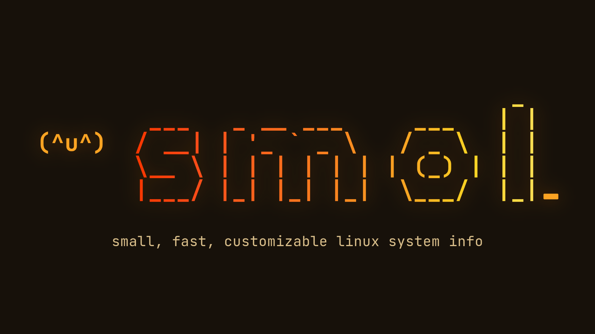

# smol

<picture>
  <source media="(prefers-color-scheme: dark)" srcset="assets/logo-dark.png">
  <source media="(prefers-color-scheme: light)" srcset="assets/logo-light.png">
  
</picture>

A one-line Linux system-info CLI for login banners and shell prompts.

```text
$ smol
Ubuntu 24.04.1 LTS · 6.8.0-48-generic · 3d 4h 4m · 4.6 GiB / 15.6 GiB
```


The demos are recorded with [VHS](https://github.com/charmbracelet/vhs) in CI
from [demos/vhs/](demos/vhs/); the gifs are committed when the tapes change
(`make demos`).

## Build and use

Requires Go **1.26.10**, GNU Make, and Linux for live system information.

```sh
make build
./dist/smol
./dist/smol --format '{user}@{host} · {cpu} · {load}'
./dist/smol --color always --shell bash
./dist/smol --list-modules
```

`make build` produces `dist/smol`; install it somewhere on your `PATH` if desired.
`make run` runs the command directly. The module path is `github.com/rigerc/smol`.

System files are read directly; smol does not spawn commands or make network
requests. The default format is unchanged. Additional modules are opt-in:

| Module | Default text | Fields (`{module:field}`) |
| --- | --- | --- |
| `os` | OS name | `id`, `version` |
| `kernel` | Release | `arch`, `release`, `name` |
| `uptime` | Duration | `days`, `hours`, `minutes`, `seconds` |
| `mem` | Used / total | `used`, `free`, `available`, `total`, `percent`, `bar` |
| `cpu` | Model (threads) | `threads`, `cores`, `freq`, `temp` |
| `load` | Three load averages | `percent` (one-minute load / logical CPUs) |
| `host`, `user`, `shell` | Hostname, user, shell | — |
| `face` | Configured asciimoji | — |
| `swap` | Used / total | `used`, `free`, `total`, `percent`, `bar` |
| `disk` | Used / total | `used`, `free`, `available`, `total`, `percent`, `bar` |
| `battery` | Charge percentage | `percent`, `status` |
| `terminal` | Terminal emulator | — |
| `desktop` | Desktop name | `wm`, `session` |
| `virt` | Virtualization environment | — |
| `time` | Local time | — |
| `processes`, `init` | Process count, init name | — |
| `machine` | Machine model | `vendor`, `board`, `bios` |
| `localip` | First non-loopback IPv4 | `ipv6`, `interface` |
| `packages` | Installed package count | — |

`--list-modules` prints `name: description`; `--list-fields` prints
`module.field: description`. A module is fetched once even when several fields
are referenced. Missing fields disappear with their separator, and unknown
fields are configuration errors. Fields do not apply to `{face}`.

Desktop, terminal, and virtualization detection use environment markers and
system files and are best effort. Bare metal has no `virt` value. `host` remains
the hostname; `machine` reads DMI or device-tree model information.
`packages` and `localip` are opt-in. Package detection reads dpkg, pacman, or apk
databases (in that order for `auto`); RPM is unsupported because it requires a
database library. Large databases may need `--timeout 100ms`.

Modules run concurrently with a shared **20 ms** timeout (`--timeout 50ms` to
adjust it). Failed or unavailable modules disappear with their preceding
separator. Prefix and suffix literals remain. Use `{{` and `}}` for literal braces.
Static output has one trailing newline. Control characters in module values are removed;
format strings containing control characters are rejected.

## Interactive setup

```sh
./dist/smol init
./dist/smol init --config ./smol.toml
```


The short tour picks the banner preset, follows its live preview through the
face steps, and stops before saving. It is recorded from
[demos/vhs/wizard.tape](demos/vhs/wizard.tape).

Setup uses inline prompts from [rigerc/tuiweave](https://github.com/rigerc/tuiweave),
with a transparent, bordered output preview below its header. The header tracks
four phases: Start, Modules, Appearance, and Finish. Related prompts
accumulate as collapsed tuiweave fields under Configuration, Face, Modules,
Appearance, Shell, and Save. Choose a preset, optional face, system modules,
fields, order, icons, styles, and shell instructions. Highlighting a choice previews it before Enter; invalid input
keeps the last valid preview. Module values are cached during setup, and random
face samples stay stable until rerolled. Enter accepts; Esc goes back; Ctrl+C or EOF cancels. Space
toggles system modules. For module order, Space grabs or drops an item and
arrows move it; Shift+Up/Down moves it directly. Long lists scroll within the
inline form, including in an 80×24 terminal. Scrolling menus show their visible
range, and module selection shows how many are selected. Limited terminals use numbered choices, comma-separated
module numbers, numeric module order, and `:back` / `:cancel`; use `none` to remove all system modules
when keeping a face. These words are ordinary text in a seed prompt.

A tuiweave FIGlet Standard banner introduces setup in a Phoenix red-to-amber gradient.
The dark palette runs from `#F83600` to `#FCDF57`; the light palette uses darker
stops for readability on cream. `COLORFGBG` supplies a background hint; unknown
backgrounds use the dark palette. `NO_COLOR` and numbered-input mode keep the
banner plain. Narrow or short terminals use a text heading. Basic mode prints
the current preview before each question; interactive previews wrap to at most
two rows, then truncate without changing the saved format.

The supplied [dark](assets/logo-dark.png) and [light](assets/logo-light.png) logo
artwork is stored unchanged. The terminal banner uses matching sampled palettes.

Setup requires terminal stdin and stderr. Prompts, previews and instructions
use stderr; after saving, stdout contains only the absolute config path and a
newline. `smol init --help` works without a terminal. Normal `smol` never launches
setup automatically.

The destination is `--config`, then `$XDG_CONFIG_HOME/smol/config.toml`, then
`$HOME/.config/smol/config.toml`. Relative paths use the startup working directory;
there is no shell expansion. Setup ignores `XDG_CONFIG_DIRS`. Existing valid
configs default to Existing and retain display settings, module options, icon
overrides, and inactive styles. Style editing supports foreground, background,
and attributes per module. The other presets apply only their defined keys. Unedited
custom formats, repeated tokens and field selectors survive; changing module
selection, a field or order normalizes the format to tokens separated by ` · `.
Comments and original TOML formatting are not retained.

Inline review shows a compact summary and preview. Choose **View full TOML** to
inspect the exact configuration with Up/Down or PgUp/PgDn; Enter or Esc returns
to review. Numbered mode prints the full TOML in the transcript.
Saving requires an explicit **Create configuration** or **Replace configuration**;
**No** is the default. Before confirmation, setup creates no config,
temporary files or directories. It refuses symlinks and special files, checks
for destination changes and publishes atomically. New files use mode 0600 and
new parent directories 0700; replacement preserves file permissions. A conflict
requires Refresh, review and fresh confirmation. Existing-file replacement has
a short final check-to-rename race with uncooperative external writers.

Cancellation before publication leaves the config unchanged; SIGTERM exits
143 and Ctrl+C/EOF exits 130. After publication, setup reports that the file was
saved even if completion output fails (exit 1). Shell commands are printed for
you to add manually; setup never executes them or edits shell files.

## Configuration

```sh
mkdir -p "${XDG_CONFIG_HOME:-$HOME/.config}/smol"
./dist/smol --print-default-config > "${XDG_CONFIG_HOME:-$HOME/.config}/smol/config.toml"
./dist/smol --check-config
```

The default file is `$XDG_CONFIG_HOME/smol/config.toml`, falling back to
`$HOME/.config/smol/config.toml`. Use `--config /path/to/config.toml` to select
another file. After the user location, smol searches each colon-separated
`$XDG_CONFIG_DIRS` directory (default `/etc/xdg`) for `smol/config.toml`.
The first existing file wins; files are never layered. No config is required.
`--list-config-paths` shows candidates in order and marks existing files with
` (found)`; with `--config`, it shows only that path.

`--print-config` prints the effective configuration as valid TOML, including
flag overrides, so it can be redirected to a new file. Default module option
tables are omitted. A malformed file prints defaults in normal operation;
`--check-config` reports errors. `--print-default-config` prints the commented
template. Examples in [presets/](presets/) can be copied into your config; there
is no runtime preset flag.

```toml
format = "{os} · {kernel} · {uptime} · {mem}"
color = "auto"

[style]
os = { fg = "cyan", bold = true }
mem = { fg = "yellow" }
```

Styles override defaults per module. Foreground (`fg`) and background (`bg`)
accept `black`, `red`, `green`, `yellow`, `blue`, `magenta`, `cyan`, `white`, their
`bright-` variants, `index:0` through `index:255`, `#RRGGBB`, or `""` for the
terminal default. Attributes are `bold`, `dim`, `italic`, `underline`, and
`reverse`. The color policy gates all attributes. Indexed/RGB colors emit their
requested ANSI form; terminal support determines their appearance. Unknown keys,
modules, and colors are rejected.

```toml
[icons]
mode = "auto"       # auto | always | never (default: never)
set = "nerd-font"   # nerd-font | ascii
separator = " "

[icons.overrides]
mem = "RAM"         # literal override; "" suppresses an icon

[style.cpu]
fg = "#a6e3a1"
bg = "index:0"
underline = true
```

Icons use [go-nf](https://github.com/lrstanley/go-nf) glyphs generated for Nerd
Fonts 3.5.1. Select a compatible terminal font (Nerd Font Mono is recommended),
or choose the ASCII set. Font detection does not run during normal rendering.
`auto` shows icons on a terminal unless `TERM=dumb`; `always` includes them in
redirected output, and `never` hides them. `NO_COLOR` affects styles, independently
of icons. `--icons` and `--icon-set` override their configuration fields; choosing
a set alone does not enable icons. Use `--icons always` for captured shell prompts.
The `icons` setup preset enables automatic Nerd Font icons. Glyph cell widths
can vary with terminal and font; custom multi-character overrides are allowed.
Unavailable values disappear with their icons and separators.
TOML decoding uses [go-toml/v2](https://github.com/pelletier/go-toml/tree/v2.2.3)
to support the supplied TOML configuration syntax
and diagnostics without maintaining a custom parser.

Flags `--format` and `--color` override configuration values. Color modes are
`auto`, `always`, and `never`; auto suppresses colors for redirected output,
`NO_COLOR`, or `TERM=dumb`. Explicit `always` overrides these choices.
`--shell none|bash|zsh|fish` controls prompt escape conventions; it does not
install shell integration. `sample.env` documents environment inputs. The app
does not load `.env` files or use the template's former `APP_ENV`/`LOG_LEVEL` settings.

A malformed or unreadable configuration silently falls back to defaults for
normal output. Run `--check-config` to see errors, including source line numbers
for TOML syntax and unknown-key errors. Exit codes: **0** for success/help,
**1** for configuration-check or output-write failure, **2** for invalid CLI input.
`--version` prints the build version (default `dev`).

## Display and module options

All controls are optional. Defaults preserve the original size precision
(KiB/MiB: zero decimals, GiB: one decimal) and duration output (`<1m`, `3d 4h 0m`).

```toml
[display.size]
unit = "iec" # iec | si
digits = -1 # automatic, or 0..6 decimal places
[display.duration]
abbreviation = true # false: "3 days 4 hours 0 minutes"
space-before-unit = false
compact = false # true omits zero units
round = false # true rounds 30 seconds up into the next minute
[display.percent]
digits = 0 # 0..6
width = 10 # 1..100; ASCII bars like [#####-----]
[display.temp]
unit = "c" # c | f | k
digits = 0 # 0..6

[modules.disk]
mount = "/" # used = total - all free blocks
[modules.time]
format = "15:04" # Go layout; also "15:04:05" or "Mon 15:04"
[modules.battery]
device = "" # first battery; e.g. "BAT1" selects another
[modules.localip]
interface = "" # first non-loopback interface
family = "ipv4" # ipv4 | ipv6
[modules.packages]
manager = "auto" # auto | dpkg | pacman | apk
```

Disk `free` includes reserved blocks; `available` is unprivileged availability.
Disk percentage uses `used / (used + available)`; a zero denominator omits
percentage and bar fields while preserving size fields.

`--debug` writes module timings and failures plus total fetch time to stderr;
stdout stays unchanged. Without `--debug`, normal runs keep stderr empty.
`--debug --animate` is a usage error because animation redraws the terminal.

## Faces and animation

Add `{face}` to your format to show an asciimoji from
[faceroll](https://github.com/rigerc/faceroll/tree/main/go). These text faces
include Unicode glyphs; a suitable terminal font is needed. Strict ASCII-only
filtering is not implemented.

```sh
./dist/smol --format '{face} {host} · {mem}'
./dist/smol --format '{face} {host}' --face-preset kitty --face-state happy
./dist/smol --format '{face} {host}' --face-seed my-machine
./dist/smol --format '{face} {host}' --animate --duration 5s
./dist/smol --list-face-presets
./dist/smol --list-face-states
```

The default format stays unchanged. Faces default to the `idle` expression and
a repeatable generated character with seed `"smol"`. The same seed and pinned
faceroll version produce the same character. Repeated `{face}` placeholders use
the same character and synchronized frame.

```toml
format = "{face} {user}@{host} · {mem}"

[face]
preset = "kitty"
state = "idle"
# Alternatively, replace preset with seed = "my-machine".
# seed = "" is also a valid deterministic seed.

[style]
face = { fg = "cyan", bold = true }
```

Set `[face] random = true` to generate a fresh character once per invocation.
It cannot be combined with a present seed (including an empty seed) or a
nonempty preset. Repeated face tokens and animation frames share that identity.
No entropy is read if face is absent or when checking/printing configuration.
An entropy failure makes the face unavailable, with diagnostics under `--debug`.

Setup offers Random, keep (stores the accepted seed) and Random every run
(stores `random = true`, without its preview seed). Reroll is explicit; revisiting
review does not change the sample.

CLI face options override configuration. `--face-preset` replaces a configured
seed and clears random; `--face-seed` replaces a configured preset and clears
random. Supplying both selectors on the CLI, or both in the file, is an error. `--face-state` selects the expression.
Face settings are validated even when the format does not include `{face}`.

Animation is enabled only through `--animate`. It redraws the complete line using
faceroll frame timings; system information is fetched once at startup.
`--duration` accepts a positive Go duration such as `5s` or `500ms`. Omit it to
animate until Ctrl+C or SIGTERM. Single-frame expressions print once and exit.

Playback requires a terminal with known width and enough columns for every
frame. Piped output, `TERM=dumb`, and insufficient or unknown width produce a
single static line. Animation stops if a terminal resize makes the line too wide.
Width is estimated using faceroll's terminal cell-width rules; fonts can vary.
Animation is rejected when `{face}` is absent or `--shell` is set to anything
other than `none`; shell-prompt embedding uses static faces.

Playback restores the cursor and ends the final frame with a newline on duration
expiry, interruption, or resize. It attempts the same cleanup after a write
failure. SIGINT exits **130**, SIGTERM exits **143**, and output failure exits
**1**. Faceroll generation and animation use the Go library directly, with no
external runtime or subprocess. Its dependency is pinned in `go.mod`.

## Development

```sh
make fix
make check
```

The Makefile selects Go 1.26.10. `make check` runs formatting checks, vet,
the pinned custom golangci-lint **v2.10.1** with anti-slop-go **v1.3.0**,
race-enabled tests, an **80%** internal statement coverage gate, and a build.
With Go 1.26.10 on Linux amd64, `go build -trimpath` measured 4,038,499 bytes
before the expansion and 4,453,166 bytes after it (+414,667 bytes, about 10.3%).
This includes the opt-in local-IP support and its standard-library `net` import;
no dependencies were added.

The first lint run requires the `golangci-lint` builder and network access.
Use `make lint`, not stock `golangci-lint run`, to load the plugin.
Run `make audit` with `govulncheck` before dependency upgrades or releases.

- `cmd/app/`: process entry point, built as `smol`.
- `internal/app/`: CLI execution with injected filesystem, environment, and writers.
- `internal/config/`: TOML defaults, strict parsing, and validation.
- `internal/modules/`: built-in system-info modules and injected detection hooks.
- `internal/displayfmt/`: shared size, duration, percent, and temperature formatting.
- `internal/render/`: format parsing, module snapshots, separators, and color escapes.
- `internal/face/`: faceroll character selection, validation, and discovery.
- `internal/playback/`: synchronous animation with checked writes and terminal cleanup.
- `testdata/`: x86 and ARM Linux fixtures used by deterministic tests.

Caching, `smol init`, GPU modules, and width truncation are not
implemented in the supplied app or this adaptation.

The template's [BSD-2-Clause license](LICENSE) is retained.
